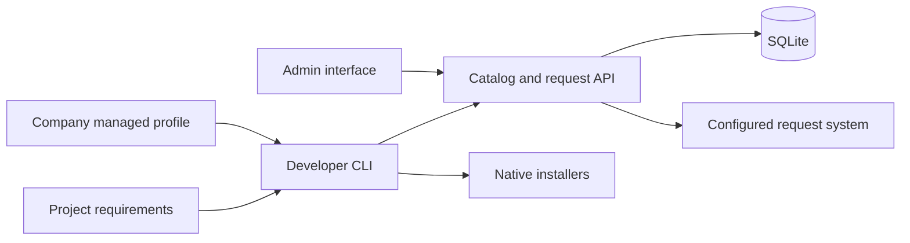

# Build Business Brew enterprise developer-tool management

## 1. Title
Build a self-hosted approved-software catalog, admin interface, and cross-platform installer CLI.

## 2. Summary
Developers use native installer commands through managed shims, or optionally
declare project tools and exact versions. Business Brew checks a centrally
published company catalog, invokes existing native installers, and submits requests
for missing approvals or packages through configurable enterprise request systems.

## 3. Task Definition
The accepted native-wrapper revision is detailed in
[the native wrapper implementation plan](docs/native-wrapper-plan.md).
Native commands automatically resolve their company-managed profile, use optional
managed repository mappings for project context, and gate every explicit target
before executing one native invocation. Blocked targets create/reuse requests.

Optional `plan` reports readiness without mutations. `setup` processes all requirements,
installs authorized available targets, and creates/reuses blocked-tool requests.
`status` reports provider progress. A catalog grant, rather than ticket status,
authorizes installation. Setup remains developer initiated.

The company-managed profile supplies developer identity and permitted projects.
The server independently binds these to a developer credential. Project requirements
cannot modify identity, credentials, approval interpretation, or installer commands.

## 4. Scope
- Go CLI for macOS, Windows, Linux; AMD64 and ARM64.
- Configurable Homebrew, WinGet, apt, dnf adapters, exact native version mappings.
- Go self-hosted service and server-rendered catalog/admin interface.
- Local administrator accounts; operator bootstrap/add/reset.
- SQLite catalog drafts, immutable publications, requests, accounts and credentials.
- Explicit organization/project/developer/combined grants.
- Jira Service Management, ServiceNow, Azure DevOps, GitHub, Linear, custom HTTP.
- Safe request lifecycle, status mappings, deduplication, focused mocked validation.
- Setup examples and container/self-hosting instructions.

## 5. Non-Goals
Later phases include paid administrator SSO, hosted SaaS onboarding and billing.
The first release does not implement automatic installation after approval,
ticket-to-grant synchronization, native-installer bootstrapping, endpoint enforcement,
project runtime isolation, repository provisioning, or arbitrary shell hooks.

## 6. Acceptance Criteria
- [x] Project tools require exact versions; no silent latest substitution.
- [x] Native source/platform/architecture and package versions are checked.
- [x] Organization is required on every grant; optional selectors combine with AND.
- [x] Grants combine with OR; zero grants denies installation.
- [x] Only published catalog revisions authorize installs.
- [x] CLI rechecks current catalog immediately before each installation.
- [x] Developer credentials cannot publish/edit catalogs or impersonate another subject.
- [x] Requests use configured scope and connector; retries reuse persistent reservations.
- [x] Unknown/ambiguous provider results do not confer installation rights.
- [x] Local accounts have salted hashes, expiring sessions, CSRF and login throttling.
- [x] UI supports structured software/grant forms and explicit publication.
- [x] Tests cover mocked providers/native commands and persistent state boundaries.
- [ ] Validate real provider workflows and native installers on target OS devices before rollout.
- [ ] Verify container deployment, ingress TLS and database backup in the deployment environment.

## 7. Architecture Impact
The repository began empty; there were no existing modules or patterns to reuse.



CLI owns local discovery/execution. Service owns catalog publications, request
submission, identity binding and credentials. Admin UI edits drafts through
session-authorized handlers. Shared policy/model code keeps authorization consistent.
Organization ownership is explicit for a later SaaS migration; the deployment is
single-organization and does not expose multi-tenant selection.

## 8. Data Model, API, and Contract Changes
Schema version 1: `Manifest`, `Profile`, `Target`, `Grant`, `Catalog`, `Draft`,
`Identity`, `Connector`, `HTTPOperation`, `RequestInput`, `SoftwareRequest`.

Targets identify exact tool version, OS/architecture, installer, package/native
version/type and source. Grants have required `organization` plus optional
`project` and `developer`. Catalog snapshots carry revision and publication time.
Drafts carry an optimistic version for conflict detection. Connector settings and
environment secret references remain on the server, outside developer snapshots.

SQLite tables: deployment, drafts, catalogs, admins, sessions, credentials,
requests, audit. There is no existing data migration or backfill; initialization
creates the initial schema. Token/session secrets are stored as hashes.

Developer bearer API:
- GET `/api/v1/identity`
- GET `/api/v1/catalog`
- POST `/api/v1/requests`
- GET `/api/v1/requests` (optional explicit provider refresh)
- GET `/api/v1/requests/{id}`

Request input cannot contain organization/developer identity. `request_type` is
approval/provisioning; requested scope is selected by published server configuration.
API failures distinguish malformed inputs, forbidden projects, invalid credentials,
missing configuration and internal persistence failures.

## 9. Security, Privacy, and Permissions
Local accounts use Argon2id salted hashes. Sessions are expiring, HTTP-only,
same-site and secure by default. All admin form mutations require CSRF. The first
administrator is explicitly bootstrapped; no public signup/default password exists.
Developer credentials support issuance/revocation and bind organization, developer,
and permitted projects. They cannot authorize admin operations.

Profiles are protected by existing company device controls, as selected by the
user. The wrapper does not prevent direct native-installer usage. Installation
uses argument arrays, no shell or automatic sudo/runas. Connector requests use
bounded responses/timeouts/pagination, explicit status mapping, structured escaping,
and no redirects carrying credentials to another host.

## 10. Legal, Compliance, Privacy, and Terms
Stored identifiers include administrator/developer IDs, permitted project IDs,
request context and audit actors. Request systems receive the software/version,
platform and scoped request context. No analytics or new telemetry service is used.
Operators must confirm their employee-data processing, retention, backup protection,
request-system permissions and applicable notice requirements before deployment.
These are deployment review requirements rather than claims of legal compliance.
The application does not automatically accept package/source license agreements.

## 11. Rollout, Migration, and Backwards Compatibility
New repository/application, with no existing client contracts or historical data.
Initial rollout uses one self-hosted service instance and a persistent local SQLite
volume behind company HTTPS ingress. Pilot with managed profiles and a small catalog.
Catalog grant removal blocks subsequent wrapper installs; it does not uninstall.
Restore service/database backups for deployment recovery; no rollback UI is introduced.
Future SaaS/SSO will add hosting/provider mechanisms without letting project files
select organization or change the current permission model.

## 12. Observability
Per-tool CLI results include installed, ready, blocked, provisioning-needed and
failure outcomes; incomplete setup returns nonzero. Request records preserve
external IDs, URLs, state, request keys and timestamps. Publication audit records
include actor, action, revision and time. Secret values/provider bodies are excluded
from errors. Operators monitor native failures, connector outages, ambiguous
submissions, persistence failures and ingress/service health during rollout.

## 13. Tests
### Unit Tests
Focused policy selector combinations, request visibility/key scopes, strict config,
password verification, native version/source/architecture and argument checks.
### Integration Tests
Temporary SQLite publication, conflicts, credential revocation, sessions, concurrent
reservations; HTTP fixtures for every preset/custom connector; service auth,
catalog authority, lookup recovery, ambiguous submission and provisioning.
### End-to-End Tests
CLI harness with fake installer/service verifies no-mutation plan/status, immediate
revocation, project identity matching, approval versus provisioning and incomplete setup.
### Regression Tests
Prevent latest substitution, invalid connector publication, grant broadening,
credential redirects, missing remote IDs, and unknown-status approval.
### Migration Tests
Initial schema/persistence reopen and rejection of a different organization ID.
No historical migration/backfill exists.
### Manual QA Scenarios
Browser verification of local sign-in, scoped target edit/save and publication using
an in-memory fixture. Live OS/provider/container checks remain deployment validation.

## 14. Code Changes
All files are new. Actual boundaries:
- `cmd/business-brew/main.go`: CLI entry point.
- `cmd/business-brew-server/main.go`: service/bootstrap/add/reset operator commands.
- `internal/model/model.go`: shared declarative contracts.
- `internal/config/config.go`: strict project/profile loading.
- `internal/cli/cli.go`: plan/setup/status workflows.
- `internal/installers/installers.go`: native adapters and shared execution boundary.
- `internal/catalog/catalog.go`: publication validation using adapter/provider validators.
- `internal/policy/policy.go`: grant evaluation, request visibility and scope keys.
- `internal/auth/password.go`: salted account hashing/verification.
- `internal/store/store.go`: organization-bound SQLite transactions and state.
- `internal/requests/http.go`, `connectors.go`: common HTTP boundary and provider contracts.
- `internal/server/server.go`, `api.go`, `admin.go`, `targets.go`: authentication,
  developer request APIs, draft/publication and structured software/grant forms.
- `web/assets.go`, `templates/`, `static/`: embedded admin assets.
- Package-focused `*_test.go` files: boundary/regression tests.
- `README.md`, `examples/`, `Dockerfile`, `compose.yaml`: onboarding/self-hosting.
No existing files were removed. Shared validators are reused across publication,
CLI and native/provider boundaries; extra generic abstraction layers are unnecessary.

## 15. Product Flows, Diagrams, Wireframes, and Code Examples
### Explicit User Flows
1. IT bootstraps admin, starts service, edits mappings/grants/configuration, publishes.
2. IT issues developer credential and deploys its matching managed profile.
3. Developer runs plan/setup with project requirements.
4. Approved and available tools install after fresh catalog check.
5. Blocked tools create/reuse approval/provisioning tickets and report incomplete setup.
6. External approval is visible; IT publishes a grant/mapping after review.
7. Developer reruns setup; native exact availability remains required.
8. Lookup failures may retry before submission; ambiguous POST results reconcile by key.
9. Admin grant removal and credential revocation take effect on subsequent checks.

### Simple Wireframes
```text
Catalog                         [Published revision]
Tool / version | Platform | Installer | Permissions | Edit
[Add software]                          [Publish saved draft]
Request integrations and advanced configuration (expand)

Software approval
Tool name [ ]   Exact version [ ]
OS [ ]  Architecture [ ]  Installer [ ]
Package [ ]  Native version [ ]  Source [ ]
[ ] Allow installation: Project [optional] Developer [optional]
[Add permission] [Save to draft]
```

### Code Shape Examples
```json
{"organization":"acme","project":"billing","developer":"alice"}
```
This grant allows that developer in that permitted project; neither selector alone
matches. An explicit organization-only grant authorizes all eligible company developers.

## 16. Implementation Tasks
1. Define models/policy and strict profile/project boundaries.
2. Add transactional persistence and local account/developer credential management.
3. Add draft editing, structured target forms and atomic publication.
4. Add configured HTTP/preset request operations and persistent deduplication.
5. Add local installer adapters and CLI workflows.
6. Review cross-layer behavior, reuse validators, address found regressions.
7. Run approved focused checks, browser fixture QA and cross-platform CLI builds.
8. Deliver setup/hosting examples and document remaining deployment validation.

## 17. Dependencies and Blockers
Direct dependencies: modernc.org/sqlite and golang.org/x/crypto.
User approved their download and focused Go tests/build checks.
Implementation has no unresolved product decisions. Live deployment requires
company connector credentials/workflow settings, managed profiles, HTTPS ingress,
and target OS devices. Container image downloads/deployment were not authorized/run.

## 18. Risks and Edge Cases
- Historical exact versions may not exist; request provisioning, never substitute.
- Package-manager privileges and dependencies retain native behavior.
- Native metadata/installation may change between discovery and mutation; verify after install.
- Partial setup remains visible and rerunnable; no destructive automatic rollback.
- Provider status and catalog authority are independent.
- Ambiguous external submissions stay reconciliation-only, avoiding blind duplication.
- Multiple service databases cannot guarantee atomic external deduplication.
- Source/version ambiguity blocks installation; invalid/conflicting drafts reject publication.
- Profiles and service credentials must stay synchronized and device-managed.
- SQLite first release assumes a single service instance/local volume.

## 19. Documentation
README describes build/bootstrap, local accounts, developer workflow, exact-version
behavior, grants, requests, API, container deployment and future SaaS/SSO phases.
Connector guide provides auth/setting schemas and official provider references.
Examples include project requirements, managed profile, draft catalog and environment.

## 20. Open Questions
No open implementation questions remain. Release-environment verification is listed above.

## 21. Final Readiness Check
- [x] Behavior/scope/non-goals and verifiable acceptance criteria.
- [x] Architecture/data/API and ownership boundaries.
- [x] Security/privacy and deployment review requirements.
- [x] Rollout/persistence/recovery and observability.
- [x] Focused test scenarios and manual/live validation boundaries.
- [x] Actual files, product flows, diagram, wireframe, contract example.
- [x] Dependencies, risks, documentation and no unresolved product assumptions.
