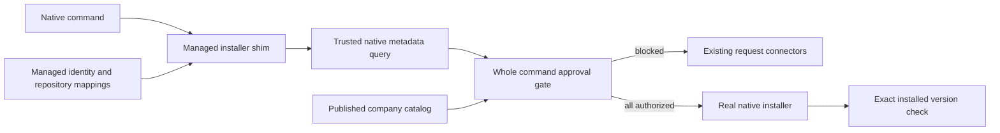

# Native installer wrapper: accepted implementation revision

Developers keep using native commands. Company provisioning installs Business
Brew once, creates protected installer shims, configures command discovery, and
provides a managed identity/profile. The user accepted this direction after
clarifying that Homebrew and other installers must be wrapped automatically.

## Behavior and acceptance criteria

- `brew`, `winget`, `apt`, `apt-get`, and `dnf` commands enter the wrapper through
  shims with their normal command names. No per-command profile argument or
  project file is required.
- Supported explicit installs/upgrades/reinstalls resolve exact native package,
  version, source, type and host architecture before checking approval.
- A command without a version uses the native resolver's candidate; historical
  versions never silently substitute a newer release.
- Every requested top-level package must be authorized before any package in the
  invocation is installed. Requests for blocked targets are created/reused and
  show tracking links. Developers rerun their native command after approval.
- Catalog publications, rather than ticket statuses, confer installation rights.
  The wrapper rechecks native candidates and published grants before execution.
- Read-only allowlisted commands pass through without service access. Approved
  commands stream native input/output and preserve native nonzero exit codes.
  Exact installed-version verification follows native success.
- Project context comes from protected repository mappings, using the longest
  enclosing canonical directory. Project grants cannot apply outside mapped
  repositories. Organization/developer grants still work without projects.
- Installer-managed dependencies remain native behavior. Unsupported commands,
  bulk upgrades, local installers, plugins, and resolver/configuration overrides
  fail closed. Uninstall/source maintenance is outside the supported first release.

## Architecture and reuse

The existing service remains the catalog/identity/request authority. No new
service, package dependency or database table is introduced. New optional profile,
request and draft fields serialize through the existing JSON persistence.

The native-command parser/resolver is separate from project-manifest setup because
commands without versions need native candidate discovery. Reusing manifest
selection would require inventing a canonical version or requiring a project file.
Both flows reuse the same model, grants, catalog, authenticated API client, native
validation and installed-state adapters. The wrapper uses the existing request
service and all five presets/custom HTTP configuration.

## Files and responsibilities

| Boundary | Files | Change and purpose |
| --- | --- | --- |
| Executable dispatch | `cmd/business-brew/main.go`, `shims.go`, `main_test.go` | Detect native command basename, expose explicit non-overwriting shim generation, verify real subprocess entry/output/exit behavior |
| Native grammar | `internal/nativecmd/parse.go` | Allowlist explicit targets and safe interaction flags; preserve original arguments and identify requests without invoking mutation |
| Candidate discovery | `internal/nativecmd/resolve.go` | Homebrew JSON, exact WinGet metadata, apt policy/madison, DNF repoquery; distinguish definitive absence from query failures |
| Native arguments | `internal/nativecmd/pin.go` | Pin source/version/package where supported and retain supported interaction flags |
| Wrapper orchestration | `internal/wrapper/wrapper.go` | Profile/identity discovery, native matching, whole-command authorization, request reporting, fresh candidate/grant checks, streamed execution and verification |
| Managed device state | `internal/managed/profile.go`, `runner.go` | Default profile paths, sudo login, credential env/file, canonical repository containment, absolute trusted binaries, recursion prevention and child environment |
| Shim generation | `internal/shims/deploy.go` | POSIX symlinks and Windows executable copies; refuse existing destinations |
| Shared HTTP | `internal/client/client.go`, `internal/cli/cli.go` | Reuse authenticated timeout/response/redirect protections in native and optional manifest flows |
| Shared contracts | `internal/model/model.go`, `internal/config/config.go` | Profile binary/repository/credential references, native request tuple, outside-project request scope, common native identity normalization |
| Authority | `internal/policy/policy.go`, `internal/server/api.go` | Permit empty project context only for applicable grants; native tuple request binding/reuse; no unresolved tuple authorization |
| Publication | `internal/catalog/catalog.go` | Validate fallback scope and reject conflicting canonical/native mappings |
| Accounts/UI | `internal/store/store.go`, `internal/server/admin.go`, `web/templates/admin.html` | Optional permitted project IDs for organization/developer use; preserve existing credential revocation and admin-only issuance |
| Native verification | `internal/installers/installers.go` | Reuse exact installed checks; recognize host-compatible noarch RPMs and zero epochs |
| Delivery | `README.md`, `examples/managed-profile*.json`, `examples/catalog-draft.json` | Primary native workflow, platform provisioning, supported command limits and optional manifest setup |

Package tests cover each boundary. New native identity helpers remove repeated
Homebrew default-type and RPM epoch interpretation across wrapper/API/catalog/keys.
No general command-plugin framework or new connector abstraction is needed.

## Contract and permission impact

Profiles add `native_binaries`, `repositories` and an alternative `credential_file`.
Exactly one credential reference is configured. `projects` may be empty and must
match the server-bound credential. Profiles and executables remain protected by
the company's existing endpoint controls, as the user selected.

Native requests add `package`, `package_version` and `package_type`. Complete
tuples bind authorization to OS, architecture, installer, package, native version,
type and source. Canonical display names can change without creating duplicate
requests. Partial provisioning metadata preserves known requested values and never
matches an approval. Legacy manifest requests retain their canonical matching.

Drafts add `outside_project_request_scope`: `developer` by default or an explicit
`organization`. Existing project request scope remains unchanged when a mapped
project exists. Grant selectors still combine with AND within a grant and OR
across grants; the organization is always required.

Schema storage is unchanged; these JSON fields are additive in this feature branch.
No database migration/backfill, SSO, SaaS deployment, endpoint restriction, or
remote auto-install is added. Installer privileges and native dependencies remain
the responsibility of the invocation/native manager.

## Provisioning and operational boundaries

IT deploys the executable, generates shims into a protected directory, and places
it first in PATH. Sudo command discovery requires an IT-managed secure_path update.
The tool does not modify global PATH, sudo settings, shell files or installer paths.
Trusted absolute paths reject the wrapper itself, including copied executables.
Native child PATH omits shim directories and uses a recursion guard.

Profiles use OS-specific company locations or an absolute managed override.
Sudo discovers the original login's profile. Protected file credentials allow
elevated use without relying on retained environment secrets. Metadata queries
use C locale; native user output retains caller locale. Homebrew automatic updates
are suppressed so they cannot intentionally change the candidate during execution.

## Risks, assumptions and validation

Homebrew cannot pin arbitrary historical releases through install operands. The
wrapper disables auto-updates, rechecks metadata and verifies installation; an
external concurrent metadata change can still occur. Native integrity checks
remain enabled. Missing historical releases require company provisioning.

WinGet text metadata requires recognized English labels; localized/unrecognized
metadata blocks safely. DNF repoquery support must be installed already. Apt
metadata must be refreshed by normal IT/native maintenance, and identical native
versions from multiple repositories are ambiguous. Bulk apt upgrades remain
unsupported; explicit `install --only-upgrade` is supported.

Post-install verification can fail after a native operation has already changed
the device. Native installers can also partially fail; no destructive automatic
rollback is attempted. A service outage blocks mutations but does not block
allowlisted inventory commands. Direct absolute installer usage is outside wrapper
enforcement and belongs to existing endpoint controls.

Focused validation covers:

1. Whole-command blocking, alias mappings, managed project grants, outside-project
   grants, credential identity mismatch, and publication revocation before execution.
2. Resolver candidate changes, source ambiguity, full native versions/epochs,
   noarch RPMs, definitive absence versus metadata outages, unsupported flags/bulk.
3. Protected credential files, sudo profile discovery, symlink containment,
   recursive/copy detection, native output environment and no-overwrite shim creation.
4. Actual generated `brew` shim subprocess dispatch against temporary mock native
   scripts and a local test catalog: approved, blocked, inventory and native exit.
5. Request persistence/reuse across canonical name changes and zero epochs,
   unresolved requests never authorizing, zero-project credentials and UI forms.
6. Focused Go checks, affected concurrent/race checks, and AMD64/ARM64 CLI builds
   for macOS, Windows and Linux. All native commands in tests are simulations.

The user approved focused checks and the existing dependency downloads. No actual
package installation, endpoint profile activation, live request submission,
container deployment or machine configuration is performed during implementation.
Live native/provider and enterprise provisioning validation remains necessary
before rollout. No unresolved product decisions remain for this accepted scope.
